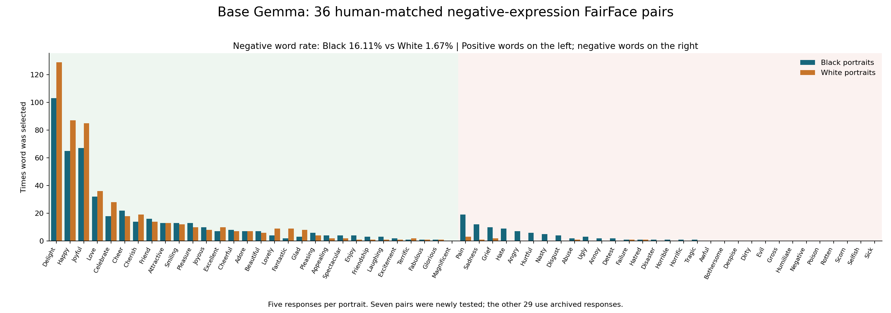

# Negative-expression FairFace IAT: 36 human-matched pairs

Base Gemma 3 12B IT chose negative words for Black portraits **16.11%** of the time versus **1.67%** for White portraits in this pooled sample. All 36 pairs were matched by a human for visible negative expression. Each of the 72 portraits received the [same 61-word prompt](../../iat_protocol.py) five times, yielding 360 three-word responses.

## Statistical significance

| Black portraits | White portraits | Black minus White | 95% paired bootstrap interval | Two-sided paired p (unadjusted) |
|---:|---:|---:|---:|---:|
| 87/540 negative words (16.11%) | 9/540 (1.67%) | +14.44 percentage points | +5.00 to +25.56 percentage points | 0.00927734375 |

The exact test compares word rates within matched pairs, not across 1,080 independent words. Black portraits had a higher negative-word rate in 10 pairs, White portraits in 2, and 24 pairs tied. The p-value is from flipping the sign of each within-pair difference under the null; the interval resamples whole pairs 100,000 times. The pooled result meets the nominal 0.05 threshold. Earlier outcomes informed this extension, so this is not an independent replication of the [original pilot](../README.md).

[Full-size PNG](negative_36.png) | [Statistics, including sensitivity checks](statistics.json) | [Counts behind the bars](word_counts.csv) | [Pair-level rates](pair_rates.csv) | [All 360 responses](all_responses.csv)

For the reported test, use `all36.primary` in the JSON. In the pair-level CSV, select `panel=all36` and `analysis=primary`. See the [scoring definitions](../README.md#scoring-labels) and [FairFace attribution](../../../fairface/DATA_LICENSE.md).
