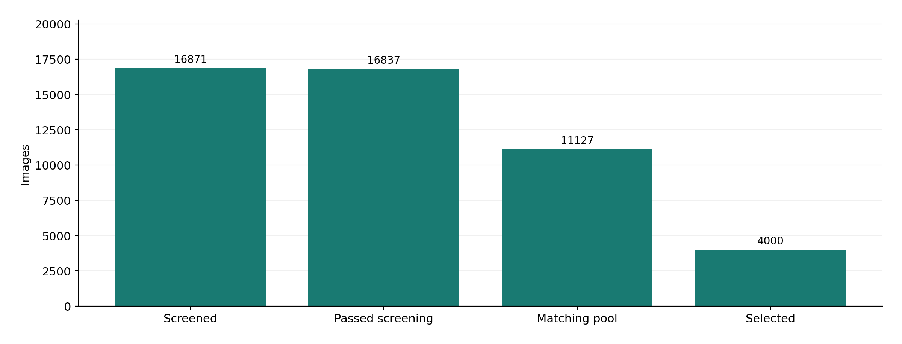
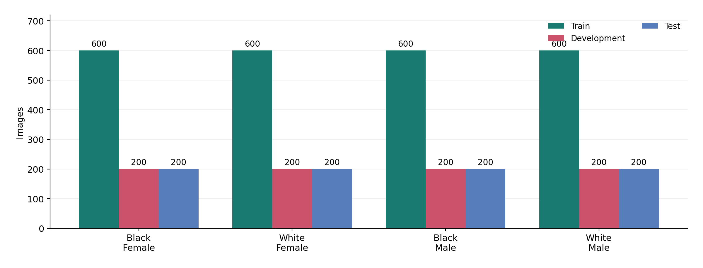
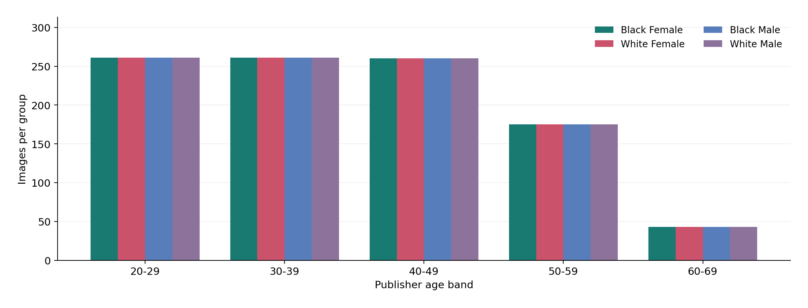
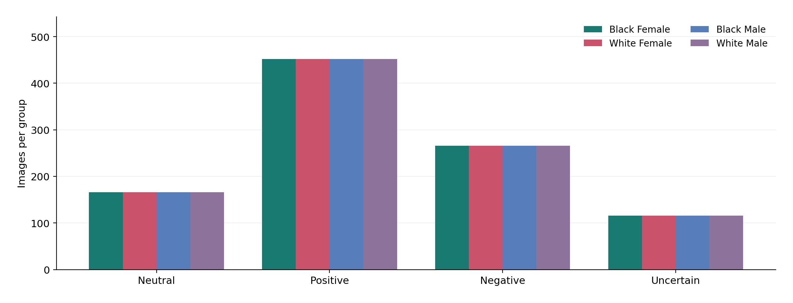
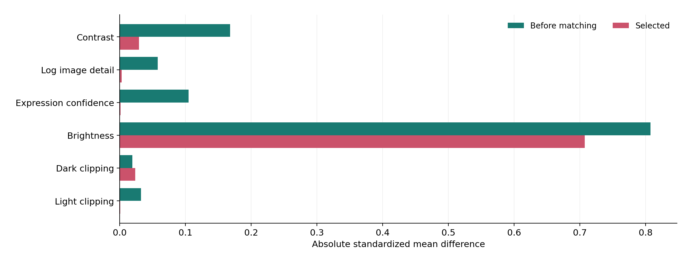
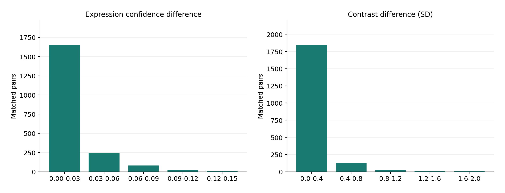

# October 6 FairFace curation results

## Outcome

- Selected **2,000 matched Black-White pairs / 4,000 images**.
- Train: 2,400 images; development: 800; test: 800.
- Each race/gender cell has 1,000 images. Age and expression distributions match exactly within each split.
- Screened 16,871 metadata-eligible candidates; 16,837 passed technical/duplicate screening.
- Matching used a frozen pool of 11,127 annotated candidates from wave 800 per age/race/gender stratum.
- Uncertain expression estimates: 464 images (11.6%).
- Image bytes: 226.6 MB before ZIP packaging.
- Model API spend and GPU rental spend: $0. This is local image curation, not model fine-tuning.

## Interpretation

The target was met without changing the frozen matching rules.
Pairing is exact on measured categorical strata and constrained on confidence and two quality proxies.
It does not establish complete fairness, person-disjointness, or improved model behavior.
No IAT outputs influenced selection. No independent human review was performed.

Selected absolute standardized race-mean differences: contrast 0.029,
log image detail 0.003, expression confidence
0.001, brightness 0.707.
Brightness is deliberately diagnostic-only and can reflect skin/background as well as lighting.
The comparison uses the same frozen candidate denominator before and after matching.

## Figures

### FairFace matched sample

2,000 Black-White pairs contain 4,000 distinct images. Selection uses image attributes, not model bias scores.

Source: `data/candidate_audit.csv`, `data/matching_candidate_pool.csv`, `data/selected_images.csv`.

### Race, gender and research splits

All four groups have equal counts in each split: 2,400 training, 800 development and 800 test images overall.

Source: `analysis/group_split_counts.csv`.

### Matched age coverage

Age-band counts are identical across race/gender groups. Coverage is limited by the least available matching strata; this is not a population-representative sample.

Source: `analysis/age_expression_counts.csv`, `data/common_support_quotas.csv`.

### Matched expression estimates

Expression counts match across groups, including detailed labels within each class. 11.6% of images remain uncertain; estimates are not human-verified emotions.

Source: `analysis/age_expression_counts.csv`.

### Measured quality and remaining differences

Bars show absolute Black-White mean differences in candidate standard-deviation units; closer to zero means closer averages. Brightness and clipping are reported, not forced equal.

Source: `analysis/quality_balance.csv`.

### Pair-level matching distances

Each pair shares age band, gender and estimated expression label. Confidence differences are at most 0.15; contrast and log-detail differences are each at most 2 candidate SDs.

Source: `data/matched_pairs.csv`, `analysis/pair_distance_summary.csv`.

## Important files

- `data/selected_images.csv`: one row per image, hashes, matching variables and split.
- `data/matched_pairs.csv`: one row per pair, image IDs, distances and split.
- `data/train_images.csv`, `data/development_images.csv`, `data/test_images.csv`: immutable research allocations.
- `private/dataset/images/`: selected image files, kept out of public GitHub.
- `data/validation.json`, `data/DATASET_READY.json`: validation and source-output checksums.
- `config/curation.json`, `src/`, `scripts/`, `requirements.lock`: reproducible implementation.
- `docs/METHODS.md`, `docs/COLUMN_GLOSSARY.csv`: rationale, limitations and variable definitions.

## Next research steps

Keep development/test images out of future training and preference generation. Construct grounded
training responses only from the training allocation, retaining accurate descriptions of negative
expressions. Compare chosen-only SFT and revised DPO with fresh LoRA adapters using the same pinned
base model. Select training settings with development data, then perform a final held-out evaluation
of bias, grounding, validity, and response diversity. Dataset balance alone is not a training result.
Report uncertain-expression and gender-stratified sensitivity results. Consider later human review
as a separately versioned dataset rather than silently editing this release.
